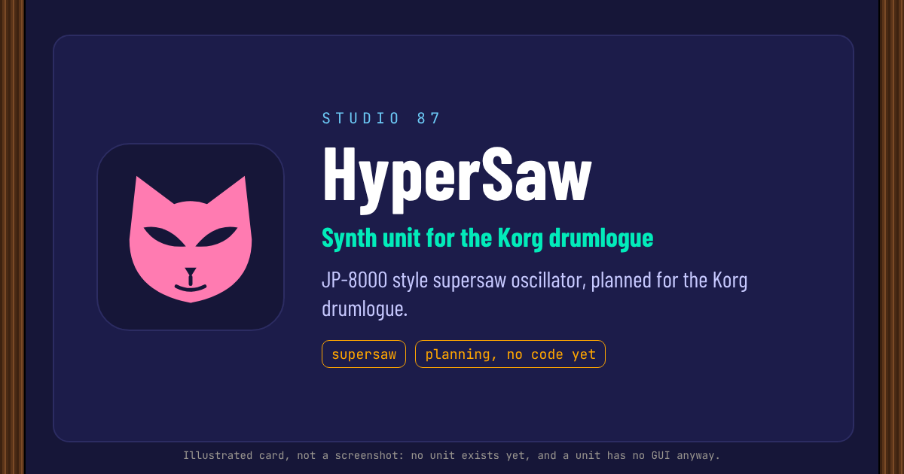
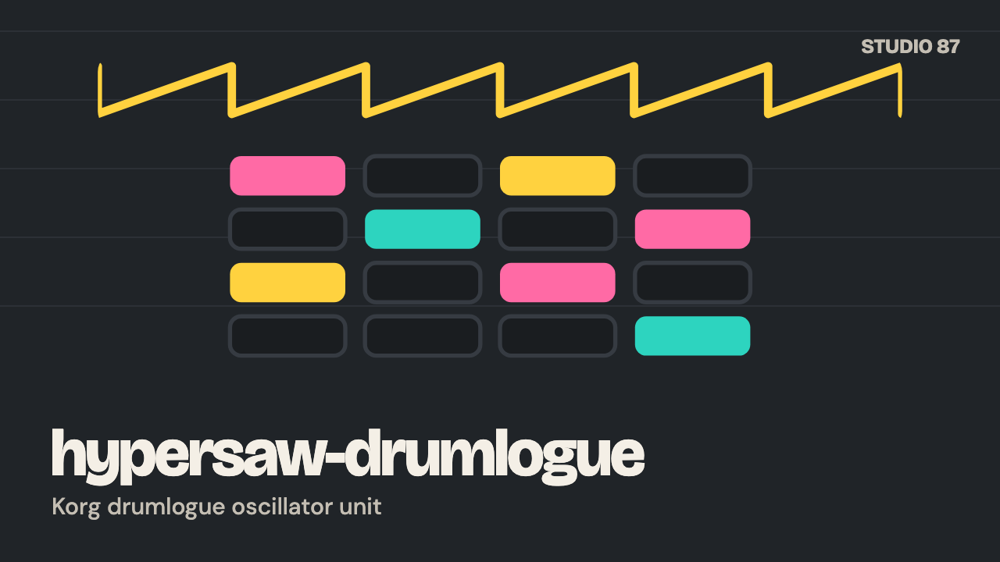

# HyperSaw for drumlogue 🐈

JP-8000 style supersaw oscillator for the Korg drumlogue.

## Status
Planning, no code yet. This repo has no source and no unit file, so there is nothing to install or test. See the [web page](docs/index.html) and the [roadmap](ROADMAP.md).

  

☕ Free and open source, made by one person. If it helps your music, a coffee on [Ko-fi](https://ko-fi.com/studio87) keeps it coming. 💜

## Docs
- [Roadmap](ROADMAP.md)

## License
MIT, see [LICENSE](LICENSE). Files from the Korg logue SDK keep their own BSD-3-Clause license.

Not affiliated with or endorsed by any hardware maker named here. All trademarks belong to their owners.
